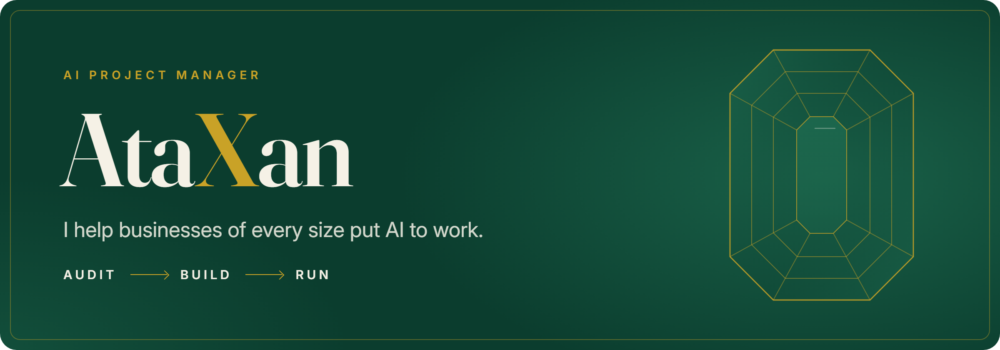
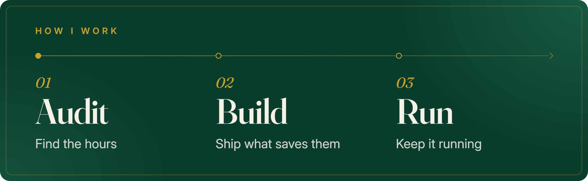
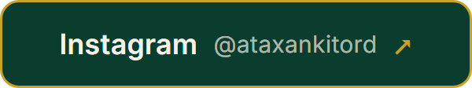

  

## Hi, I'm AtaXan

Every business, from a solo founder to a large company, loses hours each week to repetitive work: chasing follow-ups, answering the same questions, copying data from one tool to another and putting reports together. I find where those hours go, build the AI and automation that takes that work over, and keep it running, so your people can focus on the work only they can do.

  

1. **Audit.** I map how your team works today and find the hours AI can win back.
2. **Build.** I build the assistants, automations and sites that take that work over, tested step by step.
3. **Run.** I keep everything working as tools change, so your team just uses it.

## What I build

- **AI assistants** that answer customers, qualify leads and book appointments, day and night.
- **Automations** that connect the tools you already use, so follow-ups, reminders and reports happen on their own.
- **WordPress and WooCommerce sites** that load fast and plug straight into those automations.
- **Motion design**: short explainer and product videos that show what you do in seconds.

## Who I work with

Businesses of every size, from solo founders to large companies, in any industry where people repeat the same work every week: clinics, consultancies, real estate and law firms, agencies, online stores, SaaS companies, creators and coaches.

## Let's talk

Send me the word **AUDIT** on Instagram, and I'll show you the first place AI can save your team time.

  

